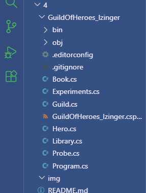
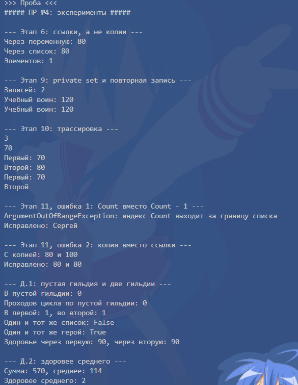

# Практическая работа № 12

Автор: Изингер Алексей  
Группа: ИСП-242  

## Приложение 


Проект: `GuildOfHeroes_Izinger` — консольное приложение на C# (.NET 9).  
Личный проект («Собственный проект»): **«Библиотека»** — классы `Book` и `Library`.

## Состав проекта

```text
4
├── GuildOfHeroes_Izinger
│   ├── .editorconfig
│   ├── .gitignore
│   ├── Book.cs
│   ├── Experiments.cs
│   ├── Guild.cs
│   ├── GuildOfHeroes_Izinger.csproj
│   ├── Hero.cs
│   ├── Library.cs
│   ├── Probe.cs
│   └── Program.cs
|
├── img
|
└── README.md
```


## Запуск

Нужен .NET SDK 9.

```bash
cd GuildOfHeroes_Izinger
dotnet build
dotnet run
```

Основной сценарий выводит сначала результат работы с героями, затем блок «Личный проект: библиотека». Пробы, трассировки, примеры «двух ошибок» и дополнительная часть собраны в `Experiments.cs`: чтобы их выполнить, уберите `//` перед `Experiments.Run();` в начале `Program.cs`, запустите `dotnet run`, после проверки верните `//`. Файл `Probe.cs` по правилу курса содержит в `Run` одну строку, а `// Probe.Run();` закомментирована.

## Практическая работа №4

Тема: коллекция объектов, ссылки и класс `Guild`. `Hero.cs` в этой работе не менялся (итог №3). Добавлены `Probe.cs`, `Guild.cs`, герой Сергей, перекличка одним циклом `foreach`, подсчёт «ящиков» и поиск самого здорового героя; в личном проекте — `Book.cs` и `Library.cs`.

### Ответы на вопросы

1. **Что хранит элемент `List<Hero>`?** Ссылку на объект `Hero`, а не его копию.
2. **Почему созданный через `new Hero(...)` объект ещё не в списке?** `new` лишь создаёт объект и отдаёт ссылку переменной. В список он попадает только после `Add`. Создать героя, создать список и добавить героя в список — три разных действия.
3. **Чем `Count` отличается от последнего индекса?** `Count` — количество элементов, а индексы идут с нуля, поэтому последний индекс равен `Count - 1`. При пяти героях доступны индексы 0–4; обращение `[5]` даёт `ArgumentOutOfRangeException`.
4. **Что обозначает `hero` в `foreach (Hero hero in guild.Heroes)`?** Переменную текущего элемента: на каждом проходе она указывает на очередного героя из списка. Новых героев цикл не создаёт.
5. **Почему урон через переменную виден и через список?** Переменная и элемент списка ссылаются на один и тот же объект, `TakeDamage` меняет единственный объект.
6. **Что `private set` у `Heroes` запрещает, а что пока разрешает?** Запрещает заменить весь список другим (`guild.Heroes = new List<Hero>();` — ошибка `CS0272`). Разрешает менять содержимое: `Add` (в том числе дважды один и тот же объект), `Remove`, `Clear`.

### Ход работы

- Этап 1. Создан `Probe.cs`; в `Program.cs` добавлена закомментированная строка `// Probe.Run();`. Для проб использованы учебные объекты, основной сценарий они не затрагивали.
- Этапы 3–5, 7. Герои собраны в список; выводятся `Count`, первый и последний (с проверкой `Count > 0`); четыре повторяющиеся строки заменены одним `foreach`; пятый участник (Сергей) добавлен одной строкой `Add`, цикл менять не пришлось.
- Этап 6. Проба на `probeHero`/`probeList`: здоровье после урона 20 — 80 и через переменную, и через список; элементов 1.
- Этап 8. Создан `Guild` (`Name` и `Heroes` с `private set`); все обращения к `heroes` заменены на `guild.Heroes`.
- Этап 9. Проба на учебной гильдии: один и тот же воин записан дважды — записей 2, после урона 30 обе строки показывают 120 (объект один). Временная строка `probeGuild.Heroes = new List<Hero>();` даёт `CS0272` и после проверки удалена (рис. 6).

### Трассировка (этап 10)

Прогноз до запуска (без компьютера):

| Индекс | Ссылка ведёт к | Health после урона |
| ---: | --- | ---: |
| 0 | `first` («Первый») | 70 |
| 1 | `second` («Второй») | 80 |
| 2 | `first` («Первый», тот же объект) | 70 |

Предполагаемый вывод (6 строк):

```text
3
70
Первый: 70
Второй: 80
Первый: 70
Второй
```

Создано объектов `Hero`: **2** (`new Hero` встречается дважды); три записи списка ведут к двум объектам.

Фактический вывод (проба `Experiments.Run()`, блок «Этап 10») совпал с прогнозом, расхождений нет. `Count - 2` при трёх элементах — индекс 1, то есть «Второй»; индексы 0 и 2 ведут к одному объекту, поэтому урон 30 виден в двух строках.

### Две ошибки (этап 11)

**Ошибка 1. Количество приняли за последний индекс.**
Прогноз: программа завершится аварийно. Причина: при пяти элементах индексы 0–4, а `guild.Heroes[guild.Heroes.Count]` обращается к индексу 5 — возникает `ArgumentOutOfRangeException`. Проверка `Count > 0` защищает только от пустого списка и здесь не помогает. Исправление: `guild.Heroes[guild.Heroes.Count - 1]` — выводится «Сергей».

**Ошибка 2. В список положили копию.**
Прогноз и результат: `80 и 100`. Второй объект появился в `probeList.Add(new Hero(probeHero.Name, probeHero.Health))` — `new Hero(...)` создаёт отдельный объект с такими же начальными данными, поэтому урон по `probeHero` на него не действует. Совпадение имени не делает объекты одним. Исправление: `probeList.Add(probeHero);` — получается `80 и 80`.

### Самостоятельный шаг (этап 12)

Подсчёт: `strongCount` увеличивается внутри `if (hero.Health >= 120)` — получилось **2** (Артём — ровно 120, и Александр — 150). Самый здоровый: **Александр (150)**; поиск выполнен одним `foreach` без сортировки и готовых методов поиска, блок внутри `if (guild.Heroes.Count > 0)`.

- *Почему начальным значением берём `guild.Heroes[0]`, а не «нового героя со здоровьем 0»?* `strongest` должен ссылаться на реального участника списка. Выдуманный герой не входит в гильдию, и если бы ни у кого не было здоровья выше нуля, программа назвала бы «самым здоровым» человека, которого в составе нет. Первый элемент — настоящий кандидат, с него сравнение корректно при любых значениях; именно поэтому блок защищён проверкой непустого списка.
- *Кто попадёт в `strongest` при одинаковом максимуме — первый или последний?* Первый. Условие строгое: `hero.Health > strongest.Health`, поэтому равный по здоровью герой ссылку не заменяет. Если заменить `>` на `>=`, в `strongest` оказался бы последний из равных.

### Личный проект: «Библиотека»

Добавлены `Book.cs` (название с очисткой пробелов через закрытое поле `_title`, автор, страницы 1–5000, цена, состояние 0–100, методы `Wear`, `Restore`, `IsUsable`, `GetInfo`) и `Library.cs` — аналог `Guild`: название и список `Books` с `private set`. В список добавлены три готовые книги, четвёртая — одной строкой `Add`; выводятся количество, первая и последняя книга (с проверкой `Count > 0`), сведения обо всех книгах одним `foreach` через `GetInfo()`.

- *Какое условие выбрано для подсчёта и почему оно имеет смысл?* «Цена выше 500 руб.» (результат: **2** — «Война и мир» и «Мастер и Маргарита»). Дорогие издания в библиотеке требуют особого учёта и аккуратности при выдаче, поэтому библиотекарю важно знать, сколько их в фонде.
- *Какой объект изменён и как проверена ссылка?* После добавления в список у «Войны и мира» вызван метод `Wear(25)`. Состояние через переменную `warAndPeace` — 75, и то же значение через `library.Books[0].Condition` — 75: в списке лежит ссылка на тот же объект, а не копия.
- *Сделан ли аналог `Guild`?* Да — `Library`: у библиотеки есть название и состав, роль класса объясняется одной фразой: «библиотека хранит ссылки на свои книги и своё название».

### Вывод программы (`dotnet run`)

```text
>>> Гильдия героев: перекличка <<<
Участников: 5
Первый: Ярослав
Последний: Сергей

>>> Ярослав <<<
Здоровье: 100
Уровень: 1
Опыт: 0

>>> Анастасия <<<
Здоровье: 90
Уровень: 1
Опыт: 0

>>> Артём <<<
Здоровье: 120
Уровень: 1
Опыт: 0

>>> Александр <<<
Здоровье: 150
Уровень: 1
Опыт: 0

>>> Сергей <<<
Здоровье: 110
Уровень: 1
Опыт: 0

Могут нести тяжёлые ящики (здоровье от 120): 2
Самый здоровый: Александр (150)
```


Вывод личного проекта:

```text
=== Личный проект: библиотека ===
>>> Городская библиотека: каталог <<<
Книг: 4
Первая: Война и мир
Последняя: Двенадцать стульев

>>> Война и мир <<<
Автор: Лев Толстой
Страниц: 1225
Цена: 650 руб.
Состояние: 100

>>> Мастер и Маргарита <<<
Автор: Михаил Булгаков
Страниц: 480
Цена: 520 руб.
Состояние: 100

>>> Преступление и наказание <<<
Автор: Фёдор Достоевский
Страниц: 592
Цена: 380 руб.
Состояние: 100

>>> Двенадцать стульев <<<
Автор: Илья Ильф и Евгений Петров
Страниц: 400
Цена: 310 руб.
Состояние: 100

Книг дороже 500 руб.: 2
Состояние «Войны и мира» через переменную: 75
Состояние «Войны и мира» через список: 75
```


### Дополнительная часть

**Д.1. Пустая гильдия и две гильдии** (`Experiments.Run()`):

- Тело цикла по пустой гильдии не выполнилось ни разу, потому что `foreach` берёт очередной элемент списка, а в пустом списке элементов нет: проходов 0.
- У двух гильдий разные списки (`ReferenceEquals` для списков — `False`), потому что инициализатор `= new List<Hero>()` выполняется для каждой новой гильдии и создаёт её собственный список. Герой же один (`ReferenceEquals` — `True`): списки хранят ссылки на один объект, поэтому урон 10 виден через обе гильдии (здоровье 90 и 90).

**Д.2. Здоровее среднего.** Сумма здоровья 570, среднее `570 / 5 = 114` (целочисленное деление), героев с большим здоровьем — **2**. Без проверки `Count > 0` на пустой гильдии выражение `sum / guild.Heroes.Count` делит целое на ноль и программа завершается с ошибкой `DivideByZeroException`.

Весь вывод экспериментов:

```text
##### ПР №4: эксперименты #####

--- Этап 6: ссылки, а не копии ---
Через переменную: 80
Через список: 80
Элементов: 1

--- Этап 9: private set и повторная запись ---
Записей: 2
Учебный воин: 120
Учебный воин: 120

--- Этап 10: трассировка ---
3
70
Первый: 70
Второй: 80
Первый: 70
Второй

--- Этап 11, ошибка 1: Count вместо Count - 1 ---
ArgumentOutOfRangeException: индекс Count выходит за границу списка
Исправлено: Сергей

--- Этап 11, ошибка 2: копия вместо ссылки ---
С копией: 80 и 100
Исправлено: 80 и 80

--- Д.1: пустая гильдия и две гильдии ---
В пустой гильдии: 0
Проходов цикла по пустой гильдии: 0
В первой: 1, во второй: 1
Один и тот же список: False
Один и тот же герой: True
Здоровье через первую: 90, через вторую: 90

--- Д.2: здоровее среднего ---
Сумма: 570, среднее: 114
Здоровее среднего: 2
```


## Скриншоты 








